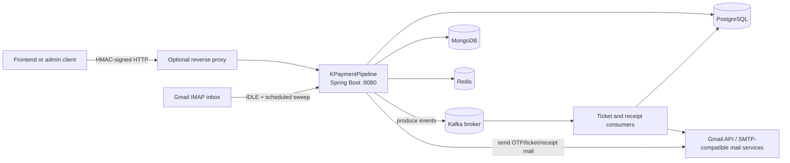
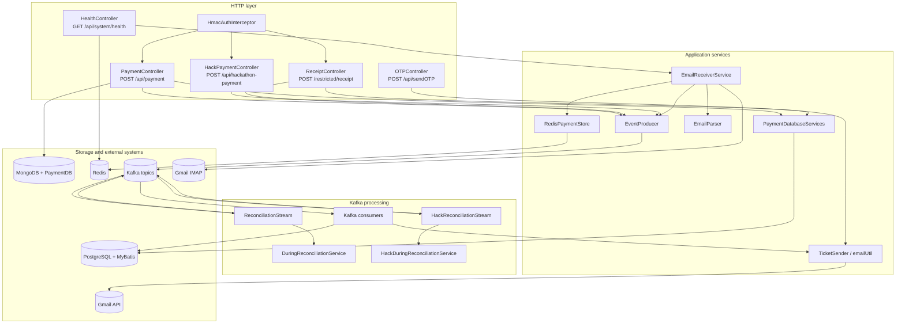
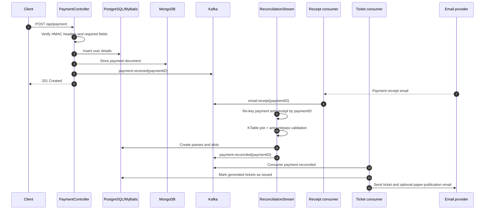
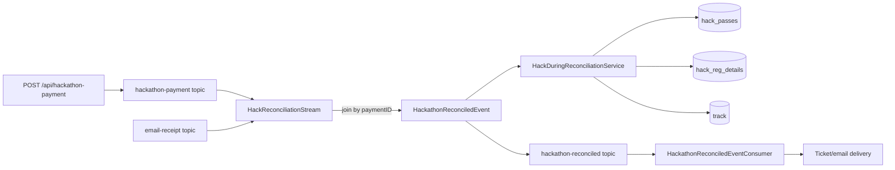

# KPaymentPipeline

KPaymentPipeline is a Spring Boot service for ingesting event payments, correlating them with payment receipts, generating event or hackathon passes, and delivering tickets by email. It was built for the Invente 2025 event platform and combines synchronous HTTP APIs with asynchronous Kafka processing.

The service is intentionally a single deployable application with several internal roles:

- HTTP API for payment, receipt, hackathon-payment, OTP, and health requests.
- IMAP email listener for receiving payment-provider emails and turning them into receipt events.
- Kafka producers and consumers for durable event distribution.
- Kafka Streams topologies for payment/receipt reconciliation.
- PostgreSQL/MyBatis persistence for users, receipts, passes, slots, and hackathon registrations.
- MongoDB persistence for payment documents/raw payment data.
- Redis for email deduplication, short-lived payment state, and health heartbeats.
- Gmail API/JavaMail integrations for OTP, receipt, and ticket delivery.

> **Architecture accuracy note:** the current code persists data and publishes Kafka events from the request/service path. The repository does not currently implement a transactional outbox table or outbox relay, so the diagrams below describe the implemented flow rather than calling it an outbox.

## Contents

- [Architecture](#architecture)
- [Processing flows](#processing-flows)
- [Kafka topics](#kafka-topics)
- [HTTP API](#http-api)
- [Repository layout](#repository-layout)
- [Technology stack](#technology-stack)
- [Local development](#local-development)
- [Configuration](#configuration)
- [Deployment options](#deployment-options)
- [Database model](#database-model)
- [Observability and operations](#observability-and-operations)
- [Load testing](#load-testing)
- [Reliability and security notes](#reliability-and-security-notes)

## Architecture

### System context



### Internal component architecture



## Processing flows

### Standard payment reconciliation



The receipt can also enter through `POST /restricted/receipt`. The IMAP listener is the automated path: it parses recent inbox messages, atomically claims message/payment keys in Redis, publishes an `email-receipt` event, and marks the message as seen only after the send path succeeds.

### Hackathon payment reconciliation



Both reconciliation topologies use Kafka Streams `KTable` joins keyed by `paymentID`. This lets payment and receipt events arrive independently; reconciliation occurs when both records are present in the state stores.

## Kafka topics

Topic names are configurable through `application.properties`. The default topic map is:

| Topic | Producer/input | Consumer/output | Purpose |
|---|---|---|---|
| `payment-received` | `EventProducer` | `ReconciliationStream`, `PaymentConsumer` | Standard payment submitted by the API |
| `email-receipt` | `EventProducer`, `EmailReceiverService` | `ReconciliationStream`, `HackReconciliationStream`, `ReceiptConsumer` | Receipt detected by API or payment mailbox |
| `payment-reconciled` | `ReconciliationStream` | `ReconciledEventConsumer` | Validated standard payment/receipt pair |
| `hackathon-payment` | `EventProducer` | `HackReconciliationStream`, `HackathonPaymentConsumer` | Hackathon team payment |
| `hackathon-reconciled` | `HackReconciliationStream` | `HackathonReconciledEventConsumer` | Validated hackathon payment/receipt pair |

Topics are created by `KafkaTopicConfig` with three partitions. Input topics retain records for seven days; reconciled topics use log compaction. The checked-in development configurations use a single broker and replication factor `1`, which is suitable for local development but not fault tolerant.

## HTTP API

All examples assume `http://localhost:8080`. Protected endpoints require:

- `X-Timestamp`: current Unix timestamp in seconds.
- `X-Signature`: Base64 HMAC-SHA256 of the timestamp using `HMAC_SHARED_SECRET`.

The interceptor accepts requests within five minutes of their timestamp.

### Submit a standard payment

`POST /api/payment`

Required fields are `emailID` and `paymentID`. The other fields are used for pass and slot generation.

```json
{
  "emailID": "participant@example.com",
  "paymentID": "pay_12345",
  "name": "Participant Name",
  "phoneNumber": "9000000000",
  "createdAt": "2025-09-01T10:00:00Z",
  "eventBookingDetails": [
    { "1": 31 },
    { "2": 25 }
  ],
  "type": "t",
  "assigned_by": "ONLINE",
  "institution": "Example University"
}
```

The controller inserts user details into PostgreSQL, stores the event through `PaymentDB` in MongoDB, publishes `payment-received`, and returns `201`.

### Submit a receipt

`POST /restricted/receipt`

Required fields are `emailID` and `paymentID`.

```json
{
  "emailID": "participant@example.com",
  "paymentID": "pay_12345",
  "paidOn": "2025-09-01T10:02:00Z",
  "method": "Card",
  "amount": "600.00",
  "phoneNumber": "9000000000"
}
```

This inserts the receipt into PostgreSQL and publishes `email-receipt`.

### Submit a hackathon payment

`POST /api/hackathon-payment`

Required fields are `leader_email` and `paymentID`.

```json
{
  "leader_email": "leader@example.com",
  "team_name": "Example Team",
  "track": "Software$Fintech$PaymentGateway",
  "paymentID": "hackpay_12345",
  "createdAt": "2025-09-01T10:00:00Z",
  "member_emails": { "1": "one@example.com", "2": "two@example.com" },
  "member_names": { "1": "Member One", "2": "Member Two" },
  "member_institutions": { "1": "Example University", "2": "Example College" },
  "member_phones": { "1": "9000000001", "2": "9000000002" },
  "member_gender": { "1": "Female", "2": "Male" },
  "member_department": { "1": "CSE", "2": "ECE" },
  "member_yearofstudy": { "1": "3", "2": "2" }
}
```

The event is published to `hackathon-payment` and later joined with `email-receipt`.

### Send an OTP email

`POST /api/sendOTP`

```json
{
  "email": "participant@example.com",
  "otp": "123456"
}
```

### Check the email listener

`GET /api/system/health`

The response reports the Redis heartbeat age and the IMAP listener's connection, scheduler, worker-pool, and running state. The endpoint returns HTTP `200` with a body status of `UP`, `STALE`, or `DOWN`; callers should inspect the JSON status rather than relying only on the HTTP status.

## Repository layout

```text
.
├── pom.xml                         Maven project and dependency definitions
├── mvnw, mvnw.cmd                  Maven wrapper
├── src/main/java/com/saipbuilds/kpaymentpipeline
│   ├── Auth/                       HMAC interceptor and MVC registration
│   ├── Controller/                 REST controllers
│   ├── DTO/                       HTTP and Kafka event types
│   ├── Database/
│   │   ├── Entities/               PostgreSQL domain entities
│   │   ├── Mapper/                 MyBatis mapper interfaces
│   │   └── MongoDB/                MongoDB payment persistence
│   ├── Email/                      IMAP listener, parser, OAuth/configuration
│   ├── ExceptionHandler/           REST error handling
│   ├── Kafka/
│   │   ├── Consumers/               Kafka listener services
│   │   ├── Producers/               Kafka event producer
│   │   ├── Reconcillation/          Standard Streams topology and validation
│   │   ├── HackathonReconciliation/ Hackathon Streams topology and validation
│   │   └── config/                  Kafka clients, Streams, and topic setup
│   ├── Redis/                      Redis configuration and atomic payment store
│   ├── Service/                    PostgreSQL workflow orchestration
│   └── TicketSender/               Ticket and email delivery helpers
├── src/main/resources/
│   └── application.properties       Runtime configuration and environment mapping
├── Kafka_Dev/                       Minimal local Kafka/PostgreSQL stack
├── docx/                            Full Docker Compose stack and initialization SQL
├── docker_fingers_crossed/          Alternative integrated deployment configuration
├── redis-setup_dev/                 Redis-only development setup
└── k6/loadtest.js                   k6 payment and receipt load test
```

## Technology stack

| Area | Technology |
|---|---|
| Language/runtime | Java 17 |
| Framework | Spring Boot 3.5.5 |
| HTTP | Spring Web, Bean Validation |
| Messaging | Apache Kafka, Spring Kafka, Kafka Streams |
| Relational persistence | PostgreSQL 15, MyBatis |
| Document persistence | MongoDB |
| Cache/deduplication | Redis 7.4, Spring Data Redis, Jedis/Lettuce configuration |
| Email ingestion | JavaMail IMAP IDLE and scheduled sweep |
| Email delivery | Gmail API and JavaMail helpers |
| Authentication | Timestamped HMAC-SHA256 request signatures |
| Operations | Spring Boot Actuator and custom email-listener health endpoint |
| Load testing | k6 |

## Local development

### Prerequisites

- Java 17
- Docker and Docker Compose
- A running PostgreSQL instance
- A running MongoDB instance
- A running Redis instance
- A running Kafka broker
- Gmail/IMAP credentials if email ingestion or mail delivery is enabled

### Build and test the application

```bash
./mvnw clean test
./mvnw spring-boot:run
```

The application listens on port `8080` by default. Override it with `APP_PORT`.

### Start development infrastructure

For a compact Kafka/PostgreSQL setup:

```bash
docker compose -f Kafka_Dev/docker-compose.yaml up -d
```

For the fuller application-oriented stack, inspect and configure the environment file expected by the compose file first:

```bash
docker compose -f docx/docker-compose.yml up -d
```

The `docx` application image expects a compiled artifact named `target/payment.jar` in its Spring Boot build context. If building that image locally, make sure the jar is copied or renamed to that path before running Compose.

Stop development services with:

```bash
docker compose -f Kafka_Dev/docker-compose.yaml down
```

Persistent PostgreSQL and Redis data are stored in Compose-managed volumes unless a compose variant says otherwise.

## Configuration

Never commit real credentials or tokens. The checked-in configuration uses environment-variable placeholders for secrets and service addresses.

| Variable | Used for | Default |
|---|---|---|
| `APP_PORT` | HTTP port | `8080` |
| `API_KEY` | MongoDB URI | required |
| `KAFKA_BOOTSTRAP_SERVERS` | Kafka bootstrap address | `localhost:9092` |
| `KAFKA_APP_ID` | Kafka Streams application id | `default-reconciliation` |
| `KAFKA_CONSUMER_GROUP` | Default consumer group | `payment-verif-group` |
| `DB_URL` | PostgreSQL JDBC URL | local `paymentdb` URL |
| `DB_USER` / database password property | PostgreSQL credentials | local development values |
| `REDIS_HOST` / `REDIS_PORT` / Redis password property | Redis connection | `localhost:6379` |
| `HMAC_SHARED_SECRET` | Request-signature verification | required |
| `EMAIL_PASSWORD` | IMAP password when OAuth is disabled | empty |
| `GMAIL_CLIENT_ID` | Gmail OAuth client id | empty |
| `GMAIL_CLIENT_SECRET` | Gmail OAuth client secret | empty |
| `GMAIL_REFRESH_TOKEN` | Gmail OAuth refresh token | empty |
| `SCHEDULED_SWEEP_TIME` | IMAP sweep interval in minutes | required by listener |
| `AMOUNT_PERPASS` | Expected standard pass amount | `300` |
| `PAPER_PRESENTATION_EVENT_IDS` | Event ids that trigger paper-publication mail | optional |
| `PAPER_PRESENTATION_GFORM_FOR_<id>` | Form link for a paper event | optional |

The topic names can be overridden with `TOPIC_PAYMENT_RECEIVED`, `TOPIC_HACKATHON_PAYMENT_RECEIVED`, `TOPIC_EMAIL_RECEIPT`, `TOPIC_PAYMENT_RECONCILED`, and `TOPIC_HACKATHON_PAYMENT_RECONCILED`.

## Deployment options

The repository includes multiple Compose variants because they target different stages of development:

- `Kafka_Dev/docker-compose.yaml`: Kafka, Zookeeper, and PostgreSQL for local development.
- `docx/docker-compose.yml`: Kafka, Zookeeper, PostgreSQL, Redis, Kafka UI, and the payment application.
- `docker_fingers_crossed/docker-compose.yaml`: integrated payment, admin-backend, and admin-frontend deployment.
- `redis-setup_dev/docker-compose.yml`: Redis-focused setup.

For production, use separate secrets management, TLS-enabled Kafka and HTTP ingress, multiple Kafka brokers, replication factor greater than one, and monitored database backups. Do not expose PostgreSQL, Redis, Kafka, or the Kafka UI directly to the public internet.

## Database model

The PostgreSQL schema in `docx/init-db/schema.sql` models the ticketing domain:

```mermaid
erDiagram
    USERS ||--o{ RECEIPTS : owns
    USERS ||--o{ PASSES : receives
    RECEIPTS ||--o{ PASSES : funds
    PASSES ||--o{ SLOTS : contains
    EVENTS ||--o{ SLOTS : schedules
    HACK_PASSES ||--o{ HACK_REG_DETAILS : includes
    HACK_PASSES ||--o| TRACK : describes

    USERS {
        text email PK
        text name
        text phone
        timestamptz created_at
    }
    RECEIPTS {
        varchar payment_id PK
        timestamp paid_on
        varchar method
        text email FK
        decimal amount
        boolean passGenerated
    }
    PASSES {
        text pass_id PK
        text user_email FK
        varchar payment_id FK
        boolean ticket_issued
    }
    SLOTS {
        text pass_id FK
        int slot_no PK
        int event_id FK
        boolean attended
    }
    HACK_PASSES {
        text team_id PK
        text leader_email
        varchar team_name
        varchar track
        varchar payment_id
        boolean ticket_issued
    }
    HACK_REG_DETAILS {
        text team_id FK
        text email PK
        varchar full_name
        varchar institution
    }
    TRACK {
        text team_id PK
        varchar domain_name
        text problem_statement
    }
    EVENTS {
        int external_id UK
        text name
        int department_id FK
    }
}
```

MongoDB stores payment documents through `Database/MongoDB/PaymentDB`. Redis stores short-lived listener state, including processed-message keys, payment claims, verification keys, and `email-listener:heartbeat`.

## Observability and operations

- Spring Boot Actuator is included for standard application metrics and health integration.
- `GET /api/system/health` reports the IMAP listener heartbeat and dependency state.
- The email listener writes a Redis heartbeat with a 90-second TTL and uses a reconnecting IMAP IDLE loop.
- A scheduled sweep revisits recent inbox messages to recover from missed IMAP notifications.
- Kafka Streams state is stored under `KAFKA_STATE_DIR`, defaulting to `kstream-state`.
- Kafka UI is available on port `8081` in the `docx` and `docker_fingers_crossed` Compose variants.
- Container logs in the integrated Compose variant use rotation settings to limit local disk growth.

For incident diagnosis, check the application logs, Kafka consumer lag, the Redis heartbeat, PostgreSQL receipt/pass flags, and the IMAP connection status together. A successful HTTP `201` means the request path accepted the event; it does not mean downstream reconciliation or email delivery has completed.

## Load testing

The k6 script in `k6/loadtest.js` sends HMAC-signed standard payment and receipt requests to `localhost:8080`.

```bash
k6 run -e SECRET_KEY="$HMAC_SHARED_SECRET" k6/loadtest.js
```

The default thresholds are:

- HTTP error rate below 1%.
- 95th percentile request duration below 500 ms.

The script contains a commented-out hackathon flow and uses generated test identifiers. Run it only against a non-production environment with a test database and test mailbox.

## Reliability and security notes

- Use unique `paymentID` values. They are the correlation key for Kafka Streams reconciliation and the primary key for receipts.
- The HMAC interceptor signs the timestamp only, not the request body. This protects freshness and caller authentication but does not provide payload integrity; if body tampering is in scope, sign a canonical request representation as well.
- The timestamp window is five minutes. Keep client and server clocks synchronized.
- Kafka producer methods log send failures but do not expose a producer future to the controllers. Monitor failed-publish logs and consider explicit acknowledgement/retry handling for stronger delivery guarantees.
- Standard payment persistence and Kafka publication are separate operations. A database success followed by a Kafka failure, or the reverse, can create a consistency gap. A transactional outbox or an explicit retry/reconciliation mechanism would address that gap.
- Kafka Streams reconciles by `paymentID` and validates the expected pass amount before creating passes. The configured single-broker replication factor is not suitable for high availability.
- Do not use wildcard trusted JSON packages or plaintext Kafka/Redis credentials in an internet-facing deployment without tightening the corresponding configuration.
- Keep secrets in environment variables or a secret manager. Rotate HMAC, database, Redis, IMAP, and Gmail credentials independently.

## License and project status

No license file is currently included in this repository. Add a license and contribution guide before distributing the project outside its current organization.
